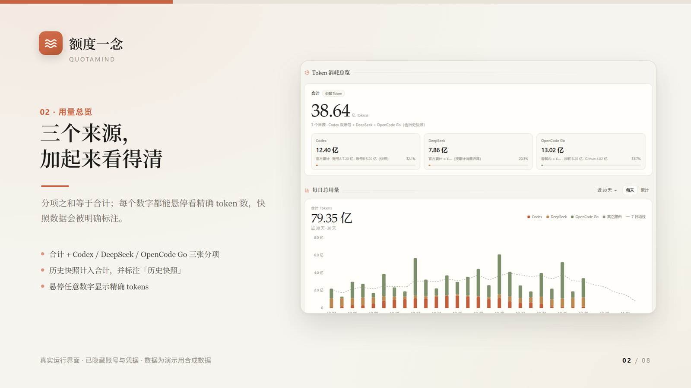

<h1 align="center">QuotaMind · 额度一念</h1>

<p align="center">
  Your AI quotas, together in one place.<br>
  A local dashboard for checking what is left and looking back at what you have used.
</p>

<p align="center">
  <a href="README.md">简体中文</a> · English
  &nbsp; | &nbsp; <a href="https://github.com/louieshadow1/QuotaMind/releases/latest"><strong>Download for Windows</strong></a>
  &nbsp; · &nbsp; <a href="#run-from-source">Run from source</a>
</p>



<p align="center"><sub>Interface preview · account details hidden · numbers are simulated</sub></p>

Using several AI services often means opening several sites just to see what is left. QuotaMind brings available quota, balance and usage information from Codex, OpenCode Go, DeepSeek and compatible relay services into a page on your own computer.

- **Check what is left.** See available balances, quota windows and reset times. When a query fails, a dated historical snapshot may be shown.
- **See your activity.** Explore daily trends and a usage heatmap, with filters for available sources, accounts or subscriptions.
- **Keep a record.** The app periodically attempts to archive collected daily data and can import CSV or JSON history. Keep a separate backup of important records.
- **Start with one source.** Add only what you use; the rest can wait.

Available fields depend on each service and your setup. Official responses, local logs, estimates and historical snapshots have different meanings. QuotaMind is for personal reference and is not a replacement for an official bill.

[▶ Watch the 17-second introduction](docs/media/quotamind-demo-17s.mp4) · The video uses simulated data and Chinese narration.

## Get started

### Windows

Download [the latest Windows x64 installer](https://github.com/louieshadow1/QuotaMind/releases/latest), quit any older running version, and open `QuotaMind-Setup.exe`. Once installed, launch **额度一念** from the Start menu. Node.js is included.

The installer is currently unsigned, so Windows may display an unknown-publisher warning.

### Run from source

Install Node.js 20 or newer, then run:

```bash
git clone https://github.com/louieshadow1/QuotaMind.git quota-board
cd quota-board
node server.mjs
```

Open [http://127.0.0.1:8799](http://127.0.0.1:8799) on the same computer. Windows users can also double-click `start.cmd`; on macOS or Linux, run `bash start.sh` from the project directory. The supplied frontend files need no build step or `npm install`.

On first launch, the three-page introduction lets you name the dashboard, choose a source and find your way around. You can skip setup and add a source later. See the [usage guide](docs/usage.md) for details (Chinese).

macOS and Linux support running from source; automated tests have run on all three platforms. Desktop environments, tray behavior and real-account scenarios have not all been verified on physical machines. There is no native mobile app.

## Supported sources

| Source | What you can see | Setup |
| --- | --- | --- |
| Codex / ChatGPT | Available account quota windows, reset times and usage; multiple accounts supported. | Can read a local Codex login or use added accounts. Results depend on login, network and service interfaces. |
| OpenCode Go | Quota windows for configured subscriptions. | Requires a Go API key. Per-subscription local DeepSeek Harness usage also needs matching route IDs and readable logs. |
| DeepSeek platform | Available balance, cumulative spending and usage. | Requires the relevant platform login; available data and interfaces may change. |
| Relay services | Account balance or token quota for configured services. | Supports New API account/token, Sub2API and custom HTTP JSON. Available fields and conversion depend on the service. |

## Frequently asked questions

<details>
<summary><strong>Can I look around before adding an API key?</strong></summary>

Yes. Skip the introduction and configure a source later from the settings near the bottom of the page. An unconfigured source may not show a quota.
</details>

<details>
<summary><strong>Why does Windows show an unknown-publisher warning?</strong></summary>

The installer is not currently digitally signed. Download it from the project's [Releases page](https://github.com/louieshadow1/QuotaMind/releases/latest) and, if desired, compare its SHA-256 hash with the value published there. You can also [run from source](#run-from-source).
</details>

<details>
<summary><strong>Why is a figure missing or different from the provider's page?</strong></summary>

Check the card's status, source configuration, login and network. Official responses, local logs, estimates and historical snapshots can cover different things. Refer to the provider for the final bill.
</details>

<details>
<summary><strong>Can I reopen the introduction?</strong></summary>

Yes. Open the “说明” (Help) panel near the bottom of the page and choose to reopen the introduction.
</details>

## Privacy and data

The service listens on `127.0.0.1` by default. Configuration, tokens and login snapshots may be stored in the local `data/` directory, and other programs with access to those files may be able to read them. When checking a quota, the app sends the required credentials to the provider or relay you configured. Choose trusted endpoints and never share your real `data/` folder, credentials or logs.

Local log availability and provider responses determine which figures can be shown. Back up history separately. Read the [security notes](SECURITY.md) and [usage guide](docs/usage.md) for more detail (Chinese).

## How it is built

A small Node.js service gathers and normalizes available data; browser files in `public/` display it. The project uses locally supplied frontend assets, with [Apache ECharts](https://github.com/apache/echarts) for charts and [Lucide](https://github.com/lucide-icons/lucide) for icons. See [third-party notices](public/vendor/README.md), [architecture](docs/architecture.md) and [development and testing](docs/development.md).

The project was shaped with help from DeepSeek Harness and OpenAI Codex. Thanks to their teams and to the open-source community. QuotaMind is independent and is not endorsed by the services it displays.

The project's original code is released under the [MIT License](LICENSE); third-party components retain their own licenses.
