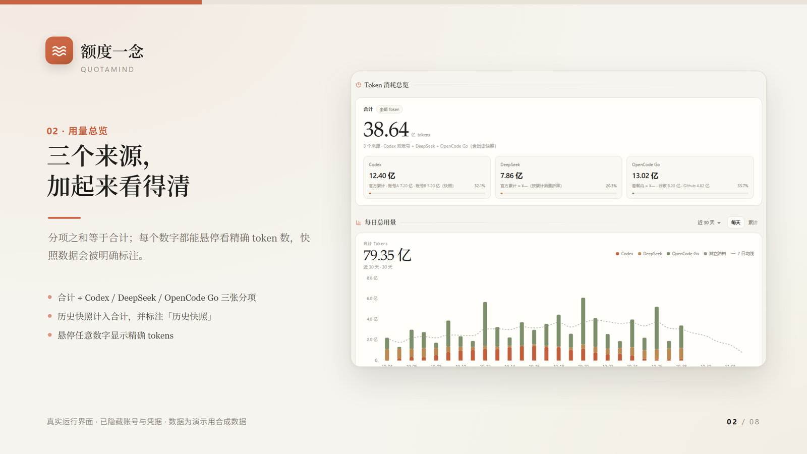
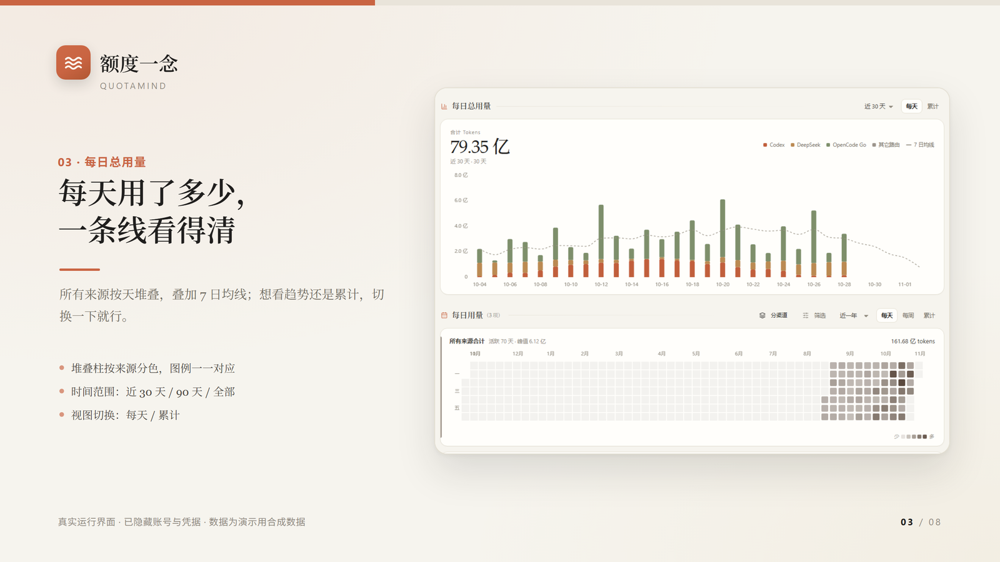
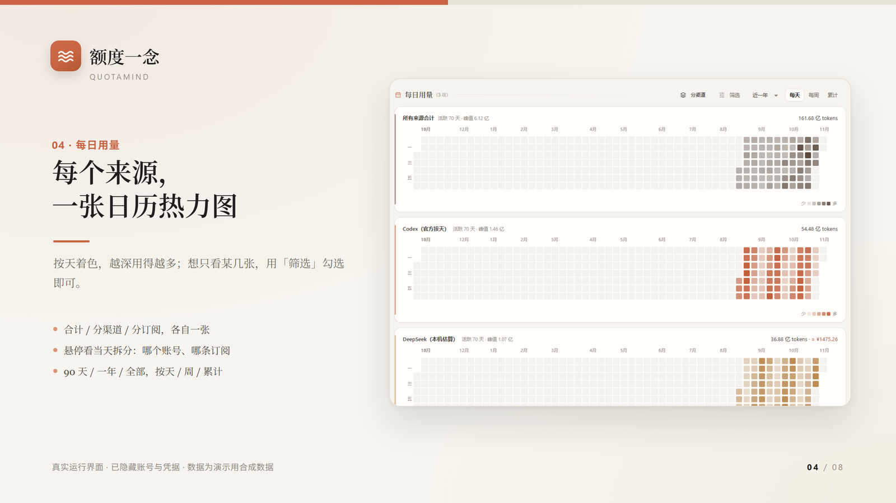
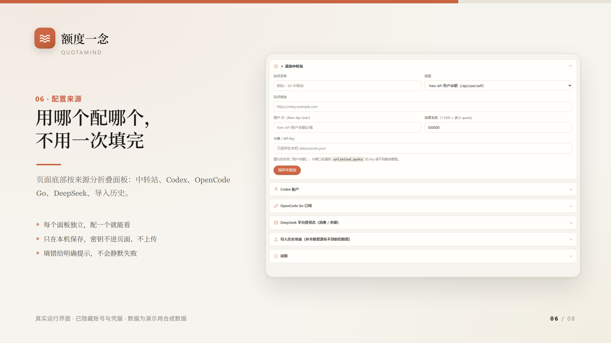
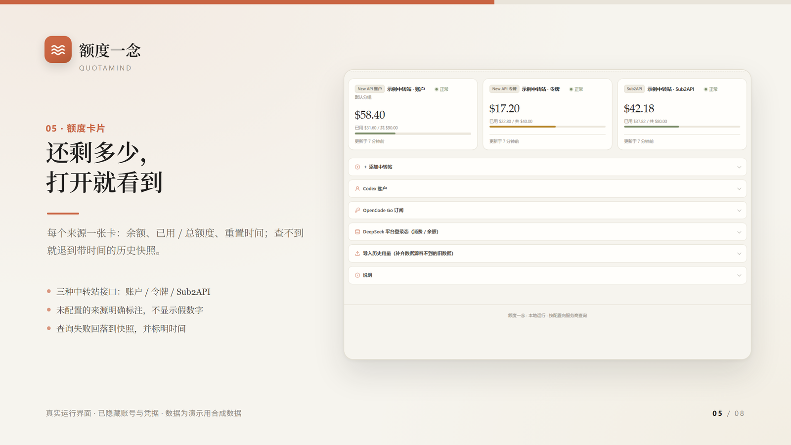
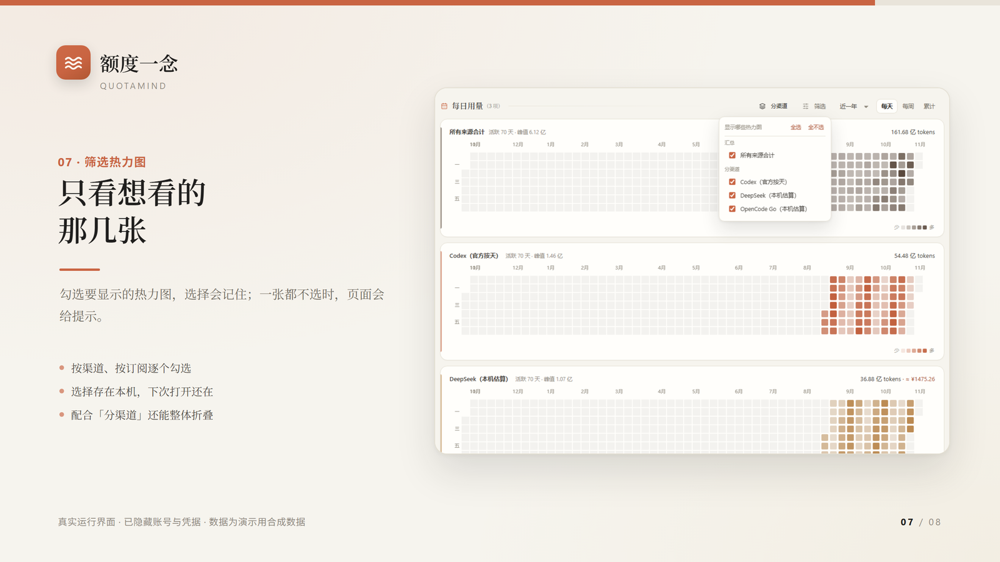
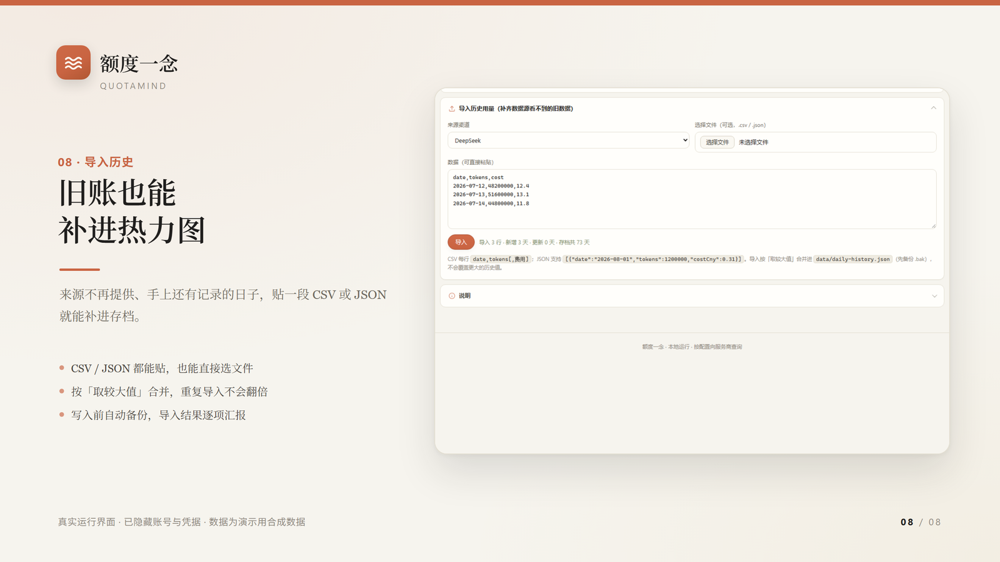

<h1 align="center">额度一念</h1>

<p align="center">
  <strong>QuotaMind</strong><br>
  把分散的额度与用量，放在一起看。
</p>

<p align="center">
  <a href="#怎么开始">快速开始</a> ·
  <a href="#支持哪些来源">支持的来源</a> ·
  <a href="#看看它长什么样">使用画面</a> ·
  <a href="#关于隐私和安全">隐私与安全</a>
</p>

**[下载 Windows 安装包](https://github.com/louieshadow1/QuotaMind/releases/latest)** · [macOS / Linux 源码运行](#怎么开始) · [支持的来源](#支持哪些来源)

Windows 安装包自带 Node.js，适用于 64 位系统；目前尚未数字签名。macOS / Linux 可从源码运行，图形界面和真实账号场景仍需进一步实机验证。



<p align="center"><sub>界面示意图 · 账号与凭据已隐藏 · 数字为演示用合成数据</sub></p>

用的 AI 工具多了，想看看还剩多少额度，常常要分别打开好几个网站。想回头看看某一天用了多少，又得去翻账单和日志。

额度一念把 Codex、OpenCode Go、DeepSeek 和中转站中能取得的额度、余额和用量放到同一个页面。它运行在自己的电脑上，需要时打开浏览器，看一眼现在，也能翻翻过去。

> 添加使用的来源，用量一页看清。看见每日的努力，记录冬夏春秋。

## 能用它做什么？

- **看额度**：配置来源后，查看能取得的余额、额度窗口和重置时间；查询失败时，也可能看到带时间标记的历史快照。
- **看趋势**：用每日图表和热力图，看看最近用得多不多，也可以按来源、账户或订阅筛选。
- **留住记录**：运行期间会定期尝试归档采集到的每日数据；手头有旧记录时，可以导入 CSV 或 JSON。重要数据仍请另行备份。
- **按需配置**：从一个来源开始就好，其他的以后再加；面板名称可以修改，桌面小窗可通过 `/widget.html` 打开。

它适合个人日常查看，不能替代各平台的正式账单。

## 怎么开始

源码需要 **Node.js 20 或更高版本**。项目已带上前端需要的文件，不用先跑 `npm install`，也不需要构建前端。

也可以克隆源码：

```bash
git clone https://github.com/louieshadow1/QuotaMind.git quota-board
cd quota-board
node server.mjs
```

然后在同一台电脑的浏览器中打开 <http://127.0.0.1:8799>。

Windows 也可以双击 `start.cmd`；macOS 和 Linux 可以在项目目录运行 `bash start.sh`。如果是在终端直接运行，按 `Ctrl+C` 停止服务。需要更换端口时，可使用 `node server.mjs --port 其他端口`。

第一次打开时，跟着引导选一个来源，按页面提示填写对应信息即可。如果暂时没有准备好凭据，跳过也没关系，之后可以在页面下方的设置里补上。完整步骤和排错方法在 [使用手册](docs/usage.md)。

### 哪些设备能用？

- **Windows**：可以从源码运行，也有由维护者另行提供的 x64 安装包。安装包自带 Node，但目前尚未数字签名。
- **macOS / Linux**：可以从源码运行，需要自行安装 Node。三平台自动测试已经在 GitHub Actions 通过；图形界面、托盘和真实账号场景还没有全部完成实机验收。
- **手机和平板**：目前没有 iOS、iPadOS 或 Android 原生应用。

查询需要连接相应平台。某些网络环境可能需要代理；启动脚本会在 Node 支持时启用内置代理选项，不支持时会提示并尝试直连。具体还要看你使用的 Node 版本和网络配置。

## 支持哪些来源？

| 来源 | 可以查看 | 配置时需要注意 |
|---|---|---|
| **Codex / ChatGPT** | 可取得的账户额度窗口、重置时间和用量，支持多账户。 | 可读取本机 Codex 登录态，也可以添加其他账户；查询结果受登录状态、接口和网络影响。 |
| **OpenCode Go** | 已配置订阅的额度窗口，支持多个订阅。 | 需要 Go API Key。要按订阅归集 DeepSeek Harness 的本机用量，还需要匹配路由 ID，并有可读取的日志。 |
| **DeepSeek 平台** | 可取得的平台余额、累计消费和用量信息。 | 需要相应平台登录态；部分接口或数据可能随服务商调整而变化。 |
| **中转站** | 已配置站点的账户余额或令牌额度。 | 支持 New API 账户 / 令牌、Sub2API 和自定义 HTTP JSON；显示字段和换算系数以站点实际情况为准。 |

不同平台给出的数据并不一样。页面里的官方返回、本机统计、估算值和历史快照，应当按各自的口径理解；空值也不一定意味着没有使用。

## 看看它长什么样

下面这些卡片来自真实运行的界面，账号名和凭据已隐藏，**图中数字是演示用合成数据**。点击图片可以查看大图。

### 用量趋势与记录

每天用了多少、哪些日子用得多，可以从趋势图和热力图里慢慢看。





<details>
<summary><strong>第一次使用：引导与配置</strong></summary>

打开后跟着引导选一个来源；不用一次把所有账号都配好。

首次引导共三步，按提示选择来源；没有准备好凭据时可以先跳过。



配置和凭据保存在本机；查询时，程序会把查询所需的凭据发送给相应的平台或你填写的中转站。

</details>

<details>
<summary><strong>查看额度、筛选与导入历史</strong></summary>







</details>

### 17 秒介绍片

演示视频正在更新，之后会使用模拟数据展示添加来源、查看用量和每日趋势。

## 这些数据是从哪里来的？

面板里的数字并非都来自同一个地方。

额度、余额和重置时间通常来自所配置的平台或中转站接口；部分用量来自本机 Codex 日志、DeepSeek Harness 会话统计，以及平台能够提供的数据。因此，换一台没有这些日志的电脑，或只配置了其中一部分来源时，看到的明细可能不同。

程序会尝试把采集到的每日数据合并到 `data/daily-history.json`。服务保持运行时，后台默认大约每 30 分钟归档一次；实际能保存什么，取决于采集是否成功以及来源有没有返回数据。导入历史时，同一天的同一字段按较大值合并，较小的更正值不会覆盖已有较大值，建议导入前先备份。

如果你发现数字与官方页面不同，可以先看看页面标记的是实时结果、估算值还是历史快照。不同平台的统计范围也可能不同，最终请以服务商提供的数据为准。

## 这个项目是怎么搭起来的？

最早的想法其实很朴素：**在自己的电脑上留一个页面，需要时打开看一眼，平时不用再到处找。** 围绕这个目标，项目把查询、统计、存档和展示拆开处理：

```text
平台接口 / 中转站 ─┐
本机日志与登录态 ──┼─→ 整理与统计 ─→ 本地服务与存档 ─→ 浏览器页面
手动导入的记录 ────┘
```

代码没有引入前端构建流程，后端主要使用 Node 内置模块。几个主要部分分别负责：

- `server.mjs`：本地服务、接口、缓存和后台归档。
- `lib/adapters.mjs`：适配不同平台的额度查询和返回格式。
- `lib/codex.mjs`、`lib/usage.mjs`：账户识别、本机日志与用量统计。
- `lib/config.mjs`、`lib/daily-history.mjs`：配置、凭据和每日历史的读写与合并。
- `public/`：页面、小窗，以及本地提供的图表和图标资源。
- `test/`：解析、接口、集成和部分对抗性场景的自动测试。

项目会在 Windows、macOS、Linux 的 Node 20 / 22 / 24 组合中运行自动测试。测试能帮我们发现一部分问题，但不代表每一种浏览器、桌面环境和账号情况都已经覆盖。

更多细节可以看 [架构说明](docs/architecture.md)、[设计原则](docs/principles.md) 和 [开发与测试](docs/development.md)。

## 关于隐私和安全

配置、令牌及登录态快照可能以文件形式保存在本机 `data/` 目录中；拥有相应本机权限的其他程序仍可能读取它们。Codex 登录态的自动归档可以在配置中关闭。

面板服务默认只监听 `127.0.0.1`，但查询额度时仍要连接你配置的平台或中转站，并发送查询所需的凭据。请确认所填写的站点可信，也不要把真实 `data/`、认证文件、日志或带有个人用量的截图分享出去。

项目做了 Host 白名单、部分跨来源写入检查和请求大小限制，但这些措施不能隔离同机的其他程序，也不能保证没有其他安全问题。多个实例请使用各自的数据目录；历史数据请定期单独备份。详见 [安全说明](SECURITY.md)。

## 致谢

项目最初的需求梳理、原型构建和说明文档，得到了 **DeepSeek Harness** 的协作支持；后续的独立测试、问题修复、界面优化和发布整理，也有 **OpenAI Codex** 的协作。感谢这一路参与项目的工具和开源社区。

图表使用了 [Apache ECharts](https://github.com/apache/echarts)，图标使用了 [Lucide](https://github.com/lucide-icons/lucide)。对应版本、许可证和声明可以在 [第三方组件说明](public/vendor/README.md) 中找到。额度一念是独立项目，致谢不代表相关平台对本项目作出官方认证或背书。

## 更多文档

[使用手册](docs/usage.md) · [架构说明](docs/architecture.md) · [设计原则](docs/principles.md) · [开发与测试](docs/development.md) · [安全说明](SECURITY.md) · [变更记录](CHANGELOG.md)

本项目原创部分采用 [MIT 许可证](LICENSE)，允许按照许可证使用、修改、再分发和商业使用；第三方组件继续遵循各自的许可证。
